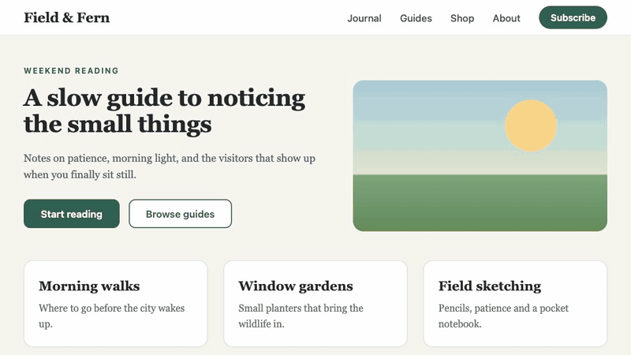

# Perch

A Chrome extension: low-poly birds visit the web page you leave idle. They
land on headings, buttons and cards, hop around and sing, and scatter if you
move too fast. Sneak up, click one to photograph it, and fill a field guide of
50 species, from house sparrows to a thunderbird.



## Install

1. Download this repo (**Code → Download ZIP**) and unzip it somewhere permanent.
2. Open `chrome://extensions` and turn on **Developer mode** (top right).
3. Click **Load unpacked** and choose the `extension` folder.
4. Reload any open tabs. Leave a page alone for about 10 seconds and birds arrive.

To update, replace the folder and click ↻ on Perch in `chrome://extensions`.

## Using it

- **Spot birds**: hover over a bird to frame it, click to take its photo. Move
  slowly; a fast cursor scares them off.
- **Field guide**: click the toolbar icon (or press Alt+Shift+B on any page), or
  click a sighting's popup to jump to that bird. Each species has a real fact,
  how it behaves in Perch, and your photos and sightings.
- **Settings**: birds on/off, sound and photos. **Dev tools** adds the idle
  time, a perch overlay (Alt+Shift+P) and summoning any species on demand.

Five tiers (Common, Uncommon, Rare, Epic, Legendary), each rarer than the last.
Some birds follow you when you switch tabs, hawks scatter small birds, crows
peck at buttons, and a rubber duck only lands on code blocks.

**Privacy**: a photo is a crop of the visible tab around the bird with
everything else heavily blurred, so text is unreadable. The screenshot is
discarded right away, the photo stays in Chrome's local storage, and nothing
is uploaded. Turn off **Photos** to stop taking them.

## How it works

Plain JavaScript modules and [three.js](https://threejs.org), no build step.

```
extension/
  manifest.json, background.js   MV3 manifest; the worker takes screenshots for photos
  content.js, perch-ext.js       loads the core on each page; settings, storage, tab handoff
  popup.html, popup.js           toolbar popup: settings and the field guide
  core/
    species.js                   the 50 species as data: look, flight, temperament, facts
    model.js                     procedural low-poly models (birds, bat, drone, origami)
    bird.js, aviary.js           per-bird state machine; arrivals, perches, startle, spotting
    perches-dom.js               finds edges to land on: visible box tops, text cap heights, rules
    stage.js, overlay.js         transparent three.js overlay, viewfinder, toasts
    book.js, photo.js            field guide and sighting photos
dev/                             playground.html for testing perches; demo.html for the video
scripts/                         build.sh (shareable zip), render-icons.sh, record-demo.mjs
```

## Development

```bash
python3 -m http.server 8000
```

Open <http://localhost:8000/dev/playground.html>: birds arrive after 4 s, the
perch overlay is on, and `perch.summon(1, 'barn_owl')` works in the console.
After changing `extension/`, click ↻ on Perch in `chrome://extensions`.

- `scripts/build.sh` zips the extension to `build/perch-extension.zip` for sharing.
- `scripts/record-demo.mjs` re-records `docs/demo.gif` (needs Chrome and ffmpeg).
- `scripts/render-icons.sh` re-renders the icons from `extension/icons/icon.svg`.

## License

[MIT](LICENSE). Includes [three.js](https://github.com/mrdoob/three.js) (MIT).
